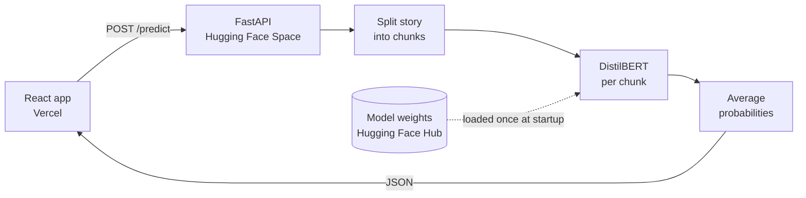

# Inside Out Emotion Classifier

A fine-tuned DistilBERT model that reads a short personal story and estimates how strongly it expresses five emotions: joy, sadness, anger, fear and disgust. The result is shown as the five characters from *Inside Out*, each sized by its percentage.

**Live demo:** https://inside-out-emotion-classifier.vercel.app
**Model:** https://huggingface.co/tishasetia13/inside-out-emotion-classifier
**API:** https://huggingface.co/spaces/tishasetia13/inside-out-api

## Results

The model was evaluated on a held-out test set that it never saw during training.

| Model | Test accuracy |
|---|---|
| TF-IDF + logistic regression (baseline) | 66.8% |
| DistilBERT, fine-tuned (this project) | **76.4%** |

Both models use the same data and the same split, so the roughly 10 point gain comes from the model, not the data.

### Example predictions

Output of the deployed model for three short stories. The highest score in each row is in bold.

| Story | Joy | Sadness | Anger | Fear | Disgust |
|---|---|---|---|---|---|
| "I opened my results and saw I had topped my class. My mother hugged me so tightly that I could barely breathe, and I could not stop smiling for the rest of the day." | **98.5%** | 0.9% | 0.1% | 0.3% | 0.2% |
| "My best friend promised to come to my birthday party. She never showed up and didn't even send a message. I kept checking my phone all evening, and I felt both hurt and furious." | 0.4% | 6.0% | **90.3%** | 1.6% | 1.8% |
| "I was terrified while waiting for my exam results and could not eat all morning. When I finally saw that I had passed, I laughed out loud and my hands were still shaking." | 1.1% | 0.7% | 0.2% | **97.6%** | 0.4% |

## How it works



1. The user writes a story in the web app (up to 5,000 characters).
2. The app sends it to the API as `POST /predict`.
3. The API splits the story into chunks at sentence boundaries, so each chunk fits the model's 64-token input window.
4. DistilBERT classifies each chunk into the five emotions.
5. The probabilities of all chunks are averaged and returned as five percentages.

Stories are processed in memory only. Nothing is stored.

## Training

- **Data:** the ISEAR dataset of short personal descriptions of emotional events. I kept five of its emotion labels (joy, sadness, anger, fear, disgust), which left 5,395 examples. After cleaning text artifacts, I split them into stratified train, validation and test sets.
- **Model:** DistilBERT, fully fine-tuned for 3 epochs in PyTorch.
- **Baseline:** TF-IDF features with logistic regression, trained and tested on the same split (`baseline.py`).
- **Notebook:** the full pipeline is in `inside_out.ipynb`.

## API

`POST /predict`

Request:

```json
{ "text": "Your story here" }
```

Response: the five emotion percentages, which sum to 100.

`GET /` is a health check and returns `{"status": "ok"}`.

## Run it locally

**Backend**

```bash
python3 -m venv .venv
source .venv/bin/activate
pip install -r requirements.txt
uvicorn main:app --port 8000
```

The model downloads from the Hugging Face Hub on first start. Interactive API docs are at `http://localhost:8000/docs`.

**Docker**

```bash
docker build -t inside-out-api .
docker run -p 7860:7860 inside-out-api
```

**Frontend**

```bash
cd frontend
npm install
npm run dev
```

The frontend calls the hosted API by default. To use your local backend, set `VITE_API_BASE_URL=http://localhost:8000` in `frontend/.env.local`.

## Project structure

```
inside_out.ipynb   Data preparation, training and evaluation
baseline.py        TF-IDF + logistic regression baseline
predict.py         Model loading, chunking and prediction
main.py            FastAPI app (/ and /predict) with CORS
Dockerfile         Container for the API
requirements.txt   Pinned Python dependencies
frontend/          React + TypeScript + Vite web app
```

## Deployment

| Part | Platform |
|---|---|
| Model weights | Hugging Face Hub |
| API (Docker) | Hugging Face Spaces |
| Web app | Vercel |

The API's CORS configuration allows only the deployed web app and `localhost:5173`.

## Limitations

- **No neutral class.** The model must pick one of five emotions, so calm or factual text is forced into the closest one, often joy.
- **Only five emotions.** ISEAR also contains shame and guilt, which I left out. Stories dominated by those feelings get mapped to something else.
- **Mixed feelings are flattened.** The model tends to return one dominant emotion with very high confidence, even when a story clearly contains two. In the last example above, the story ends in relief and laughter, yet fear scores 97.6% and joy 1.1%.
- **Chunk averaging can blur results.** A story with several moods can end up as a near tie between two emotions.
- **64-token window.** Each chunk is short, so very long sentences are cut off.
- **High confidence is not correctness.** The percentages are model probabilities and should not be read as a measure of how accurate the answer is.
- **Narrow training data.** The model was trained on short ISEAR stories, so informal text, slang and other languages are outside what it learned.
- **Slow first request.** The API may take a while to answer after a period of inactivity.
